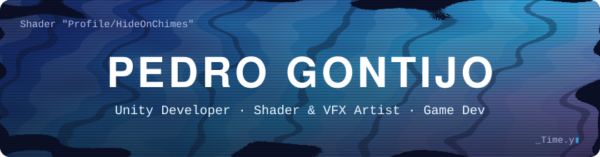
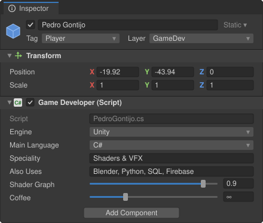
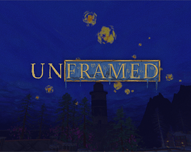
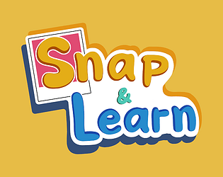
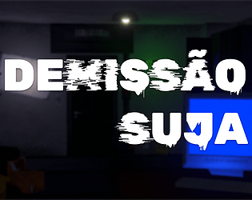
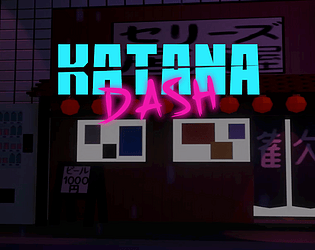
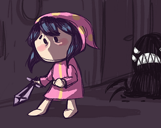
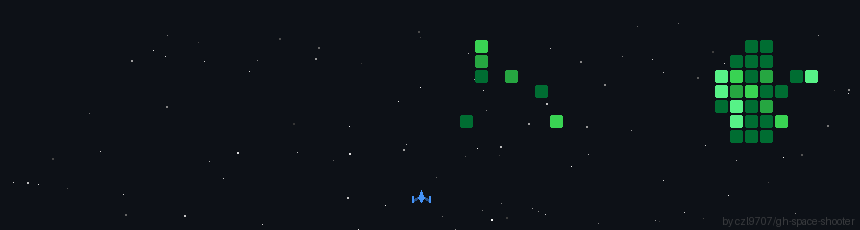

 

 

  

---

### 🔍 About Me

---

### 🎮 My Games

<table>
  <tr>
    <td align="center"><a href="https://uupedrin.itch.io/unframed"> <b>Unframed</b></a> Action</td>
    <td align="center"><a href="https://uupedrin.itch.io/snap-n-learn"> <b>Snap &amp; Learn</b></a> Educational</td>
    <td align="center"><a href="https://uupedrin.itch.io/demissao-suja"> <b>Demissão Suja</b></a> Platformer</td>
    <td align="center"><a href="https://uupedrin.itch.io/katana-dash"> <b>Katana Dash</b></a> Platformer</td>
    <td align="center"><a href="https://uupedrin.itch.io/late-night-sandwich"> <b>Sanduíche da Meia-Noite</b></a> Adventure</td>
  </tr>
</table>

---

### 🛠️ My Tech Stack

---

### 📌 Featured Repos

 

---

### 📊 My GitHub Stats

 

---

### 🚀 My Contributions

---

